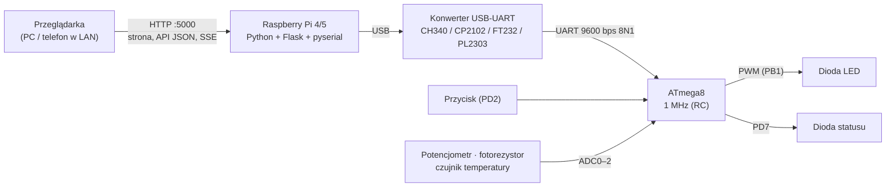
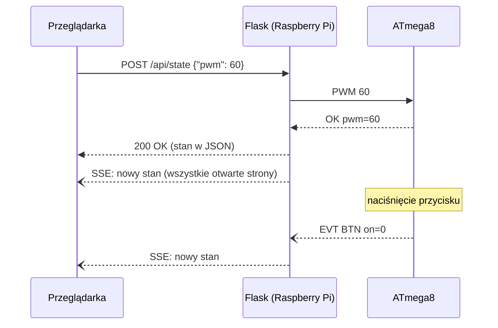

# Zdalne sterowanie urządzeniem niskonapięciowym przez sieć LAN

**ATmega8 + Raspberry Pi + Flask** – inteligentne oświetlenie LED sterowane z przeglądarki w szkolnej sieci LAN.
Projekt zespołowy z przedmiotu *Pracownia Urządzeń Techniki Komputerowej*.


> Repozytorium jest publiczne wyłącznie do wglądu. Kopiowanie i wykorzystywanie kodu bez zgody autorów jest zabronione – patrz [LICENSE](LICENSE).

---

## Spis treści

1. [O projekcie](#o-projekcie)
2. [Funkcje](#funkcje)
3. [Architektura](#architektura)
4. [Harmonogram](#harmonogram)
5. [Sprzęt](#sprzęt)
6. [Protokół i API](#protokół-i-api)
7. [Struktura repozytorium](#struktura-repozytorium)
8. [Szybki start](#szybki-start)
9. [Praca na komputerze szkolnym](#praca-na-komputerze-szkolnym)
10. [Sposób pracy zespołu](#sposób-pracy-zespołu)
11. [Testy i weryfikacja](#testy-i-weryfikacja)
12. [Dokumentacja i sprawozdania](#dokumentacja-i-sprawozdania)
13. [Zespół](#zespół)
14. [Licencja](#licencja)

---

## O projekcie

**Temat:** Zdalny system sterowania urządzeniem niskonapięciowym przez sieć LAN (mikrokontroler ATmega8 + serwer WWW na Raspberry Pi).

**Cel:** zaprojektować, uruchomić i przetestować układ zdalnego sterowania z poziomu przeglądarki internetowej w szkolnej sieci LAN.

Realizujemy **wariant zaawansowany**. Oprócz wymaganego włączania i wyłączania urządzenia system:
- reguluje jasność diody (PWM 0–100 %, płynne przejścia),
- obsługuje sterowanie lokalne przyciskiem i potencjometrem; zmiany lokalne od razu widać na stronie,
- w trybie **AUTO** dobiera jasność do oświetlenia otoczenia (fotorezystor),
- mierzy temperaturę i alarmuje po przekroczeniu progu,
- pokazuje stan na żywo (Server-Sent Events) na komputerze i telefonie,
- po zaniku zasilania sam wraca do ostatniego stanu (EEPROM, watchdog),
- automatycznie wykrywa konwerter USB-UART i łączy się ponownie po jego odłączeniu.

## Funkcje

| | Funkcja | Etap | Status |
|---|---|---|---|
| Minimum | Sterowanie diodą z kodu (GPIO, DDRx/PORTx) | 1 | 🧪 kod gotowy |
| Minimum | Komendy `1` / `0` przez UART z terminala | 2 | 🧪 kod gotowy |
| Minimum | Serwer Flask: `/on`, `/off` przez sieć LAN | 3 | 🧪 kod gotowy |
| Minimum | Strona WWW: Włącz / Wyłącz / Stan, testy, pomiary | 4 | 🧪 kod gotowy |
| R1 | PWM jasności z płynnym przejściem (Timer1) | 1 | 🧪 kod gotowy |
| R2 | Programowy debouncing przycisku (takt 1 ms, Timer2) | 1 | 🧪 kod gotowy |
| R3 | UART na przerwaniach, bufor kołowy, komendy, odpowiedzi i zdarzenia | 2 | 🧪 kod gotowy |
| R4 | Pomiary ADC: potencjometr, fotorezystor, temperatura | 2 | 🧪 kod gotowy |
| R5 | Tryb AUTO (jasność według oświetlenia) | 4 | 🧪 kod gotowy |
| R6 | Watchdog i przywracanie stanu z EEPROM | 2 | 🧪 kod gotowy |
| R7 | Wykrywanie konwertera, ponowne łączenie, API JSON | 3 | 🧪 kod gotowy |
| R8 | Tryb symulacji bez sprzętu i testy pytest | 3 | 🧪 kod gotowy |
| R9 | Interfejs WWW na żywo (SSE), responsywny | 4 | 🧪 kod gotowy |
| R10 | Autostart serwera (systemd) | 3 | 🧪 plik usługi gotowy |
| R11 | Alarm przekroczenia temperatury | 4 | 🧪 kod gotowy |

🧪 – kod gotowy i sprawdzony w symulacji (simavr, testy automatyczne); czeka na test na sprzęcie.

## Architektura



Przepływ zmiany stanu z przeglądarki oraz zmiany lokalnej z przycisku:



| Warstwa | Technologia | Katalog |
|---|---|---|
| Mikrokontroler | C (gnu99), avr-gcc, avr-libc, USBasp | `firmware/` |
| Mostek sieciowy | Python 3, Flask, pyserial, systemd | `server/` |
| Interfejs | HTML, CSS, JavaScript (bez frameworków i CDN) | `server/` (pliki statyczne, od etapu 4) |
| Dokumentacja | Markdown → DOCX (szablon szkolny) | `docs/`, `tools/` |

## Harmonogram

| Etap | Zakres | Termin | Status |
|---|---|---|---|
| 1 | Układ bazowy: ATmega8 + GPIO | **04.11.2026** | ⏳ w toku |
| 2 | Komunikacja szeregowa UART | **18.11.2026** | ⏳ |
| 3 | Mostek sieciowy: Raspberry Pi + Flask | **09.12.2026** | ⏳ |
| 4 | Interfejs WWW, testy, dokumentacja | **13.01.2027** | ⏳ |

Szczegóły (zadania, przeglądy, ryzyka): [docs/PLAN_PROJEKTU.md](docs/PLAN_PROJEKTU.md), wersja do oddania: `docs/PLAN_PROJEKTU.docx`.

## Sprzęt

| Element | Rola |
|---|---|
| ATmega8 (DIP-28), fabryczne RC 1 MHz | sterownik urządzenia |
| USBasp | programator ISP |
| Konwerter USB-UART (dowolny: CH340 / CP2102 / FT232RL / PL2303) | most USB ↔ UART |
| Raspberry Pi 4 lub 5 | serwer WWW w sieci LAN |
| Dioda LED + 330 Ω (PB1), dioda statusu (PD7), przycisk (PD2) | wykonanie i sterowanie lokalne |
| Potencjometr 10 kΩ (ADC0), fotorezystor (ADC1), czujnik temperatury (ADC2) | pomiary i tryb AUTO |

Pełna lista, przypisanie pinów, zasilanie, poziomy logiczne konwerterów i fusebity: **[docs/sprzet.md](docs/sprzet.md)**.

## Protokół i API

UART 9600 bps 8N1. Pojedyncze `1` / `0` działają bez Entera (zgodność z instrukcją), a rozszerzone komendy to linie tekstu:

```
> PWM 60          < OK pwm=60
> GET             < STATE on=1 pwm=60 mode=MANUAL pot=512 ldr=301 temp=23.5 alarm=0 tlim=50 up=1234
                  < EVT BTN on=0      (zdarzenie: przycisk)
```

API HTTP (port 5000): `GET /on`, `GET /off`, `GET|POST /api/state`, `GET /api/events` (SSE), `GET /api/health`, `GET /api/log`, a w trybie symulacji `GET|POST /api/sim`.

Pełna specyfikacja: **[docs/protokol.md](docs/protokol.md)**.

## Struktura repozytorium

```
.
├── CLAUDE.md                  zasady pracy (także dla asystenta AI)
├── README.md
├── LICENSE                    wszelkie prawa zastrzeżone
├── firmware/                  ATmega8 – C, avr-gcc
│   ├── Makefile               make / flash / demo / check / read-fuses
│   ├── include/               pinout.h (piny), config.h (czujnik, progi), nagłówki modułów
│   ├── src/                   main, uart, pwm, adc, button, timer, sensors, state, protocol
│   └── demo/etap1.c           prosty program demonstracyjny etapu 1 (make demo)
├── server/                    Raspberry Pi – Flask + pyserial
│   ├── app/                   serwer: device.py (łącze z MCU), routes.py (API), mcu_sim.py, avrsim.py
│   │   └── static/            strona WWW (HTML, CSS, JS)
│   ├── tests/                 pytest: protokół, symulator, API, firmware w simavr
│   ├── deploy/                usługa systemd (autostart)
│   ├── requirements.txt
│   └── requirements-dev.txt   + pytest
├── sim/                       symulacja firmware w simavr (tylko Linux)
│   ├── avrsim.c               firmware.hex + UART na pseudoterminalu + wirtualne czujniki
│   └── Makefile               pobiera simavr, buduje avrsim, make run / make test
├── docs/
│   ├── PLAN_PROJEKTU.md/.docx plan, harmonogram, ryzyka
│   ├── sprzet.md              elementy, piny, zasilanie
│   ├── protokol.md            protokół UART i API HTTP
│   ├── sprawozdania/          sprawozdania z etapów (md → docx)
│   ├── szablony/              szkolny szablon sprawozdania
│   └── materialy/             materiały prowadzącego (tylko lokalnie, poza gitem)
├── tools/
│   ├── md2docx.ps1            Markdown → DOCX na szkolnym szablonie
│   ├── github-tymczasowo.ps1  GitHub bez śladów na komputerze szkolnym
│   └── ntc_table.py           tabela przeliczenia NTC dla firmware
└── .github/
    └── pull_request_template.md
```

## Szybki start

### Wymagania

| Komputer | Potrzebne |
|---|---|
| Windows (szkoła / dom) | [Arduino IDE](https://www.arduino.cc/en/software) (dostarcza avr-gcc 7.3 i avrdude 8.0) **lub** WinAVR; GNU Make; Git; sterownik USBasp |
| Linux | `sudo apt install gcc-avr avr-libc avrdude make git` (Fedora: `sudo dnf install avr-gcc avr-libc avrdude`) albo avr-gcc z Arduino IDE; do symulacji także `gcc` i Python 3.11+ |
| macOS | `brew tap osx-cross/avr && brew install avr-gcc avrdude` |
| Raspberry Pi | Raspberry Pi OS, Python 3 z `venv`, Git |

Na Windows `make` jest m.in. w WinAVR (`utils\bin`). Polecenia uruchamiamy z PowerShell lub Git Bash.

### Firmware

```bash
cd firmware
make toolchain     # sprawdza, który avr-gcc / avrdude zostanie użyty
make               # kompilacja -> build/firmware.hex + zajętość pamięci
make check         # USBasp podłączony? odczyt sygnatury ATmega8
make flash         # wgranie programu
make demo          # program demonstracyjny etapu 1 (miganie, przycisk) -> build/demo.hex
make flash-demo    # wgranie programu demonstracyjnego
```

- Typ czujnika temperatury, napięcie odniesienia ADC, progi trybu AUTO i alarmu ustawia się w `firmware/include/config.h`.

- Makefile sam znajduje toolchain z Arduino IDE (Windows, Linux, macOS), a w drugiej kolejności używa narzędzi z `PATH`. Wymuszenie: `make AVR_BIN=C:/sciezka/bin/ AVRDUDE=C:/sciezka/avrdude.exe`.
- Zegar ISP jest ustawiony na ok. 125 kHz (`-B 8`), bo ATmega8 pracuje na 1 MHz.
- USBasp na Windows wymaga sterownika libusb, który instaluje się programem Zadig (potrzebne uprawnienia administratora). Jeśli `make check` nie widzi programatora, problemem jest zwykle sterownik.
- **Fusebitów nie zapisujemy** – tylko `make read-fuses` (odczyt). Fabryczne: `lfuse 0xE1`, `hfuse 0xD9`.

### Serwer na Raspberry Pi

```bash
git clone https://github.com/kotoanidev/szkola-zdalne-sterowanie.git
cd szkola-zdalne-sterowanie/server
python3 -m venv .venv
.venv/bin/pip install -r requirements.txt
groups                     # użytkownik musi należeć do grupy dialout (dostęp do /dev/ttyUSB*)
.venv/bin/python -m app    # start na porcie 5000, konwerter wykrywany automatycznie
```

Test z innego komputera w sieci: `http://[IP_MALINY]:5000/on`, a strona WWW: `http://[IP_MALINY]:5000/`.

Konfiguracja przez zmienne środowiskowe:

| Zmienna | Domyślnie | Znaczenie |
|---|---|---|
| `SERIAL_PORT` | autowykrywanie (CH340, CP2102, FT232R, PL2303) | port ręcznie, np. `/dev/ttyUSB0` albo `COM5` |
| `HOST`, `PORT` | `0.0.0.0`, `5000` | adres i port serwera |
| `POLL_INTERVAL` | `1.0` | co ile sekund serwer odczytuje stan (`GET`) |
| `SIMULATE` | – | `1` – symulator w Pythonie, `avr` – firmware w simavr (tylko Linux) |

Autostart (systemd, repozytorium w katalogu domowym użytkownika):

```bash
sudo cp deploy/zdalne-sterowanie@.service /etc/systemd/system/
sudo systemctl daemon-reload
sudo systemctl enable --now zdalne-sterowanie@$USER
journalctl -u zdalne-sterowanie@$USER -f    # log serwera
```

### Tryb symulacji

Serwer i strona WWW działają bez sprzętu. W trybie symulacji strona ma dodatkowy panel **Wirtualna płytka** (przycisk, potencjometr, światło, temperatura, reset, zanik zasilania).

| Symulator | Polecenie | Co symuluje | System |
|---|---|---|---|
| Model w Pythonie | `SIMULATE=1 .venv/bin/python -m app` | protokół i logikę firmware (bez kodu C) | Windows, Linux |
| simavr | `SIMULATE=avr .venv/bin/python -m app` | **prawdziwy** `firmware.hex` na emulowanym ATmega8 1 MHz | Linux |

Na Windows (PowerShell): `$env:SIMULATE = "1"; .venv\Scripts\python -m app`.

simavr wymaga jednorazowego zbudowania (pobiera simavr 1.8 do `sim/.deps/`, poza gitem):

```bash
make -C sim          # simavr + sim/build/avrsim + firmware
make -C sim test     # testy prawdziwego firmware w symulatorze
make -C sim run      # sam symulator; UART na pseudoterminalu sim/build/uart
```

`make -C sim run` pozwala podłączyć się do emulowanego UART dowolnym terminalem, np. `picocom -b 9600 sim/build/uart`, albo serwerem: `SERIAL_PORT=$PWD/sim/build/uart`. Sterowanie wirtualnym sprzętem: linie na wejściu symulatora (`btn press`, `pot 0-1023`, `ldr 0-1023`, `temp 25`, `reset`, `power`, `quit`).

## Praca na komputerze szkolnym

Komputer w pracowni jest współdzielony, więc **po pracy nie mogą na nim zostać żadne loginy**. Do pracy z GitHubem służy skrypt, który:
- pobiera przenośny GitHub CLI do `%TEMP%` (bez uprawnień administratora, z weryfikacją SHA256),
- trzyma token tylko w tym folderze, nie w Menedżerze poświadczeń Windows,
- loguje kodem jednorazowym wpisanym **na telefonie** (github.com/login/device), więc w przeglądarce szkolnej nie zostaje sesja,
- przy wylogowaniu usuwa gh, token i ewentualne wpisy w `.gitconfig`.

```powershell
powershell -NoProfile -ExecutionPolicy Bypass -File tools\github-tymczasowo.ps1 -Akcja Zaloguj
powershell -NoProfile -ExecutionPolicy Bypass -File tools\github-tymczasowo.ps1 -Akcja Wypchnij
powershell -NoProfile -ExecutionPolicy Bypass -File tools\github-tymczasowo.ps1 -Akcja Wyloguj   # ZAWSZE na koniec
```

Pobieranie zmian (`git pull`) z publicznego repozytorium nie wymaga logowania. Token można dodatkowo unieważnić w GitHub → Settings → Applications → Authorized OAuth Apps → GitHub CLI.

## Sposób pracy zespołu

| Zasada | Opis |
|---|---|
| Gałęzie | `main` zawsze działa; prace na `etapN-krotki-opis` |
| Pull Requesty | każda większa zmiana przez PR z listą kontrolną → przegląd Wiktora → merge |
| Commity | po polsku, krótko, w trybie rozkazującym („Dodaj obsługę UART”) |
| Komentarze w kodzie | minimalne, po polsku; opis rozwiązań w `docs/` |
| Przed commitem | `make` bez ostrzeżeń; od etapu 3 także `pytest` |
| Zakończenie etapu | weryfikacja z instrukcji pokazana prowadzącemu, kod w `main`, przegląd zakończony, sprawozdanie gotowe |

Zasady szczegółowe (konwencje firmware, serwera i front-endu, bezpieczeństwo sprzętu): [CLAUDE.md](CLAUDE.md).

## Testy i weryfikacja

| Etap | Weryfikacja wg instrukcji | Nasze testy dodatkowe |
|---|---|---|
| 1 | miganie / włączanie diody na rozkaz z kodu | przycisk, PWM 0 / 50 / 100 %, odczyt fusebitów |
| 2 | dioda reaguje na znaki z klawiatury (`1` / `0`) | wszystkie komendy protokołu, błędne komendy, zdarzenia, reset i EEPROM |
| 3 | `http://[IP_MALINY]:5000/on` zapala diodę | testy pytest (symulator), odłączenie i ponowne podłączenie USB, autostart |
| 4 | pełna demonstracja dla prowadzącego | seria przełączeń, praca ciągła, zanik zasilania, pomiary napięć i prądów |

Testy automatyczne (`cd server && .venv/bin/python -m pytest`): protokół, symulator w Pythonie, API i SSE, a po `make -C sim` także testy prawdziwego firmware w simavr (komendy i błędy, PWM z korekcją gamma i płynnym przejściem, przycisk, potencjometr, tryb AUTO, alarm temperatury, stan z EEPROM po zaniku zasilania, serwer od przeglądarki do firmware). Nie zastępują one prób na sprzęcie.

Wyniki trafiają do sprawozdań i dokumentacji technicznej wyłącznie z rzeczywistych prób.

## Dokumentacja i sprawozdania

| Dokument | Opis |
|---|---|
| [docs/PLAN_PROJEKTU.md](docs/PLAN_PROJEKTU.md) | plan, harmonogram, rozszerzenia, ryzyka (`.docx` do oddania) |
| [docs/sprzet.md](docs/sprzet.md) | sprzęt, połączenia, piny |
| [docs/protokol.md](docs/protokol.md) | protokół UART, API HTTP |
| [docs/sprawozdania/](docs/sprawozdania/) | sprawozdania z etapów 1–4 |

Sprawozdania piszemy w Markdown i zamieniamy na `.docx` w szkolnym szablonie (nagłówek, stopka, style):

```powershell
powershell -NoProfile -ExecutionPolicy Bypass -File tools\md2docx.ps1 docs\sprawozdania\etap1.md
```

Konwerter obsługuje nagłówki, akapity, listy, tabele, bloki kodu, pogrubienia i `kod`. Pola nagłówka (Zespół, Etap, Nazwa etapu, Data) bierze z front matter na początku pliku.

## Zespół

| Osoba | Rola |
|---|---|
| **Mikołaj Milcarz** | firmware (C / ATmega8), serwer (Python / Flask / Raspberry Pi), interfejs WWW, montaż |
| **Wiktor Selwon** | przegląd kodu, weryfikacja i testy, pomiary, dokumentacja, sprawozdania |

## Licencja

Copyright © 2026 Mikołaj Milcarz, Wiktor Selwon. **Wszelkie prawa zastrzeżone.**
Repozytorium jest udostępnione wyłącznie do wglądu – szczegóły w pliku [LICENSE](LICENSE).
